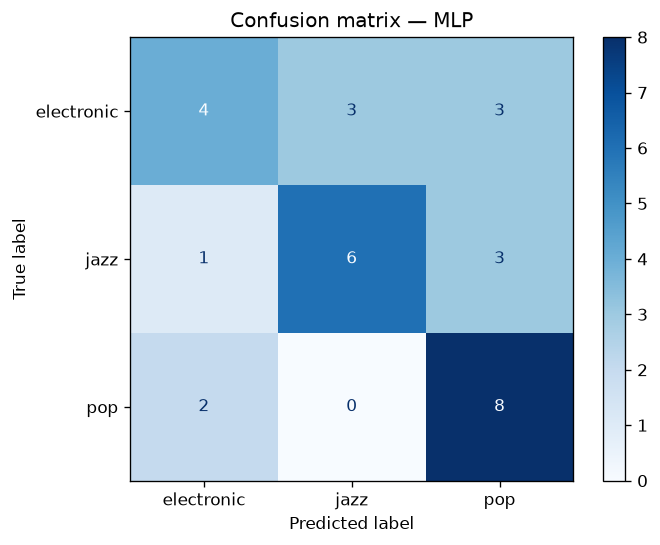
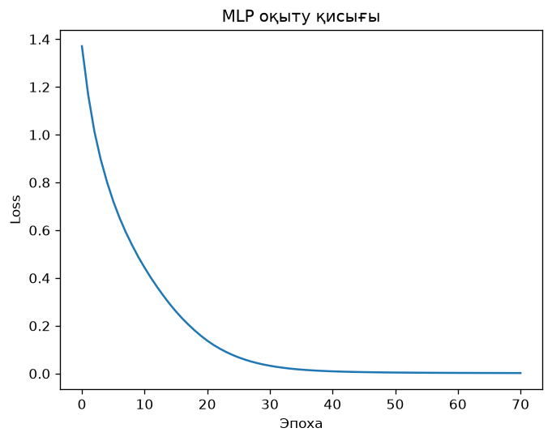

# Music Genre Classification

A small machine learning project that classifies songs into three genres — **electronic**, **jazz** and **pop** — using hand-crafted audio features and a multilayer perceptron (MLP) neural network.

## How it works

1. **Clip cutting** (`cut_clips.py`) — each song is decoded to mono 22 050 Hz and a 30-second clip is cut from its middle.
2. **Feature extraction** (`extract_features.py`) — 89 features are computed for each clip with `librosa` (mean and standard deviation over time):

   | Feature | What it captures |
   |---|---|
   | MFCC (20 coefficients) | timbre |
   | Chroma (12 pitch classes) | harmony |
   | Spectral centroid, bandwidth, rolloff | brightness and shape of the spectrum |
   | Spectral contrast (7 bands) | difference between peaks and valleys |
   | Zero-crossing rate | noisiness, percussion |
   | RMS | energy / loudness |
   | Tempo | beats per minute |

3. **Training** (`train.py`) — `StandardScaler` + `MLPClassifier` with hidden layers `128 → 64 → 32`, evaluated with stratified 5-fold cross-validation, then trained on the full dataset and saved to `genre_model.joblib`.
4. **Prediction** (`test.py`) — classifies any audio file and prints the probability of each genre.

## Dataset

30 songs, 10 per genre (e.g. Avicii, Daft Punk and David Guetta for electronic; Miles Davis, Dave Brubeck and Nina Simone for jazz; Taylor Swift, Maroon 5 and Dua Lipa for pop).

The audio is included in the `data/` folder for educational purposes:

```
data/
├── raw/              original songs
│   ├── electronic/
│   ├── jazz/
│   └── pop/
├── clips/            30-second .wav clips used for training (same genre folders)
├── test_raw/         6 extra songs for testing the model
└── test_clips/       30-second .wav clips of the test songs
```

To train on your own music, put songs into `data/raw/<genre>/` and rerun the pipeline below.

## Results

5-fold cross-validation on 30 songs:

| Genre | Precision | Recall | F1-score |
|---|---|---|---|
| electronic | 0.57 | 0.40 | 0.47 |
| jazz | 0.67 | 0.60 | 0.63 |
| pop | 0.57 | 0.80 | 0.67 |
| **Accuracy** | | | **0.60** |

With three classes, random guessing would give about 0.33. The dataset is very small, so the scores vary noticeably between folds.

| Confusion matrix | Training loss |
|---|---|
|  |  |

## Installation

Requires Python 3.10+.

```bash
git clone https://github.com/alooxaa/Music-genre-classification-project.git
cd Music-genre-classification-project
python -m venv .venv
.venv\Scripts\activate          # Windows
# source .venv/bin/activate     # Linux / macOS
pip install -r requirements.txt
```

## Usage

Classify a song with the pretrained model:

```bash
python test.py "path/to/song.mp3"
```

Or run `python test.py` without arguments for interactive mode, where you can paste paths (or drag files into the terminal) one by one.

Example output:

```
🎵 Chet Baker - I fall in love too easily.wav
   Genre: JAZZ  (100%)
   jazz          100% █████████████████████████████
   electronic      0%
   pop             0%
```

Retrain the model:

```bash
python cut_clips.py          # data/raw → data/clips
python extract_features.py   # data/clips → features.csv
python train.py              # features.csv → genre_model.joblib + plots
```

## Project structure

```
├── data/                   audio dataset (see above)
├── cut_clips.py            # cut 30 s clips from songs
├── extract_features.py     # compute audio features → features.csv
├── train.py                # train and evaluate the MLP
├── test.py                 # predict the genre of new songs
├── features.csv            # extracted features for 30 songs
├── genre_model.joblib      # trained model
├── confusion_matrix.png
├── loss_curve.png
└── requirements.txt
```

## Tech stack

Python · librosa · PyAV · scikit-learn · pandas · NumPy · matplotlib
